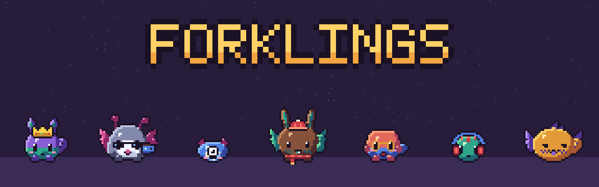
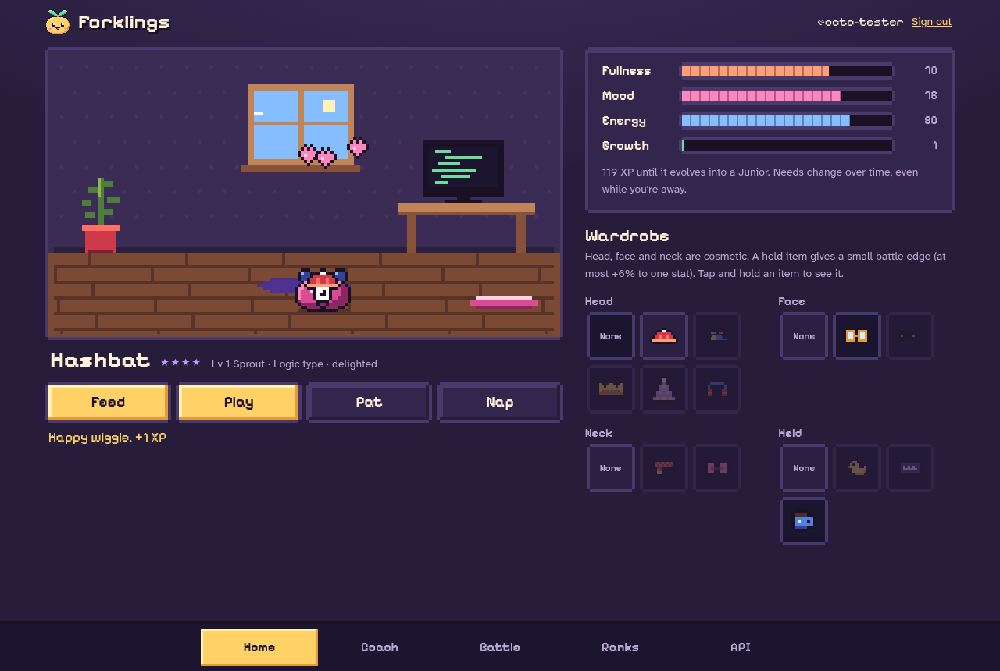
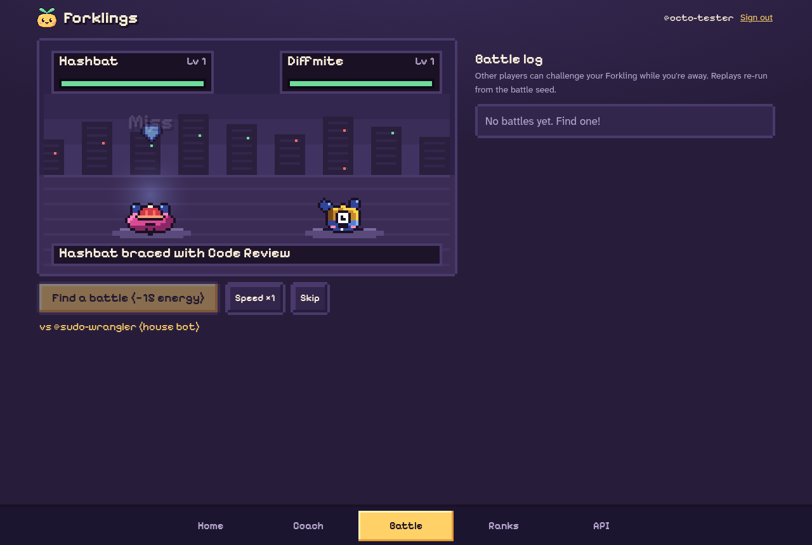
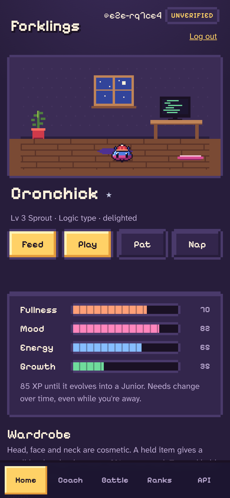
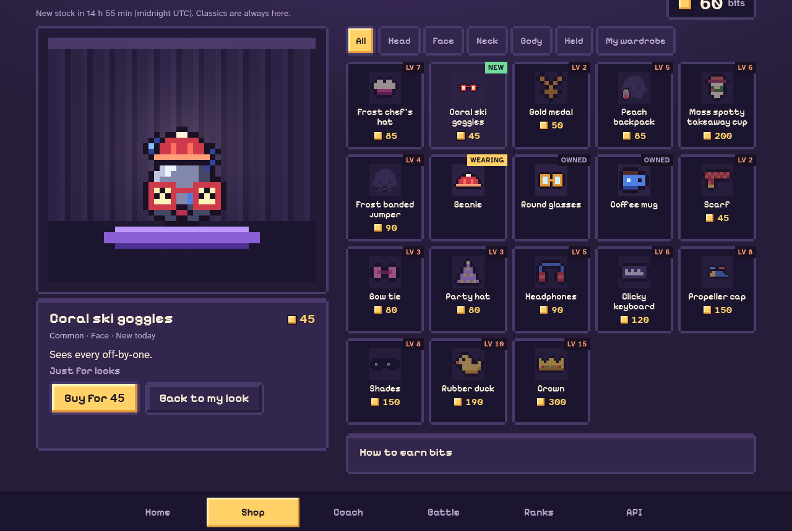
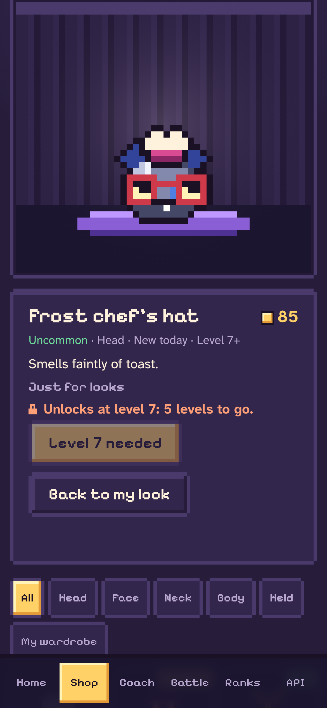

<p align="center"></p>

<p align="center"><b>A tiny pixel pet for developers. Hatch one, look after it, coach it, and let it battle while you code.</b><br>
<a href="https://forklings.dev">Play at forklings.dev</a> · <a href="docs/claude-code.md">Play from Claude Code</a> · <a href="docs/strategy-scripts.md">Strategy scripts</a> · <a href="docs/architecture.md">Architecture</a></p>

<p align="center"></p>

Every Forkling is a 32×32 creature built from code: no hand-drawn sprites and no image model. The art above comes straight from the game's generator (`bun scripts/art.ts`).

## How it works

- **Hatch.** Your egg's seed is a hash of your handle, the second you pressed Hatch and a server-side salt. The same seed always gives the same creature, but nobody can aim for a rare one.
- **Look after it.** Fullness, mood and energy drift over time, even while you're away. Feed, play, pat and nap to keep it happy. Care and battles earn XP, and it evolves from Sprout to Junior to Prime.
- **Dress it up.** Hats, glasses, scarves and outfits are cosmetic. One held item gives a small battle edge, capped at +6% to one stat.
- **Shop.** Battles, daily care and level-ups earn bits, which can't be bought. Every night at 00:00 UTC the shop makes six new items from code, each checked against everything sold before so no two look alike. Try them on in the fitting room, then buy with two taps. Rarer items unlock at higher levels. See [the economy](docs/economy.md).
- **Coach it.** Set tactics with a few sliders, or write a [strategy script](docs/strategy-scripts.md) such as `when hp < 40 and ready heal: heal`.
- **Battle.** Fights are automatic and deterministic. Each one is a seed plus two snapshots, so every replay is exact. A ladder of clearly marked NPCs plays around the clock.
- **Ranked play** is for GitHub accounts at least 30 days old. Demo players and newer accounts battle NPCs and house bots without a rating. GitHub is used only for identity: the game never reads your repositories or activity.

| Home | Battle | Phone |
| --- | --- | --- |
|  |  |  |

| Shop | Shop on a phone |
| --- | --- |
|  |  |

## Play from your terminal

Forklings has an MCP server at `https://forklings.dev/mcp` and a Claude Code plugin:

```text
/plugin marketplace add tvdavies/forklings
/plugin install forklings@forklings
/forklings:forkling feed
```

Create a token on the site's **API** tab first. [docs/claude-code.md](docs/claude-code.md) covers the status line and setup for Pi, Codex and other MCP clients.

## Quick start

You need Node 22+ and [Bun](https://bun.sh).

```sh
npm install
npm run typecheck && npm run lint && npm test
npm run dev            # wrangler dev on http://localhost:8787
```

For local development, put the secrets in `.dev.vars`, which git ignores:

```sh
HATCH_SALT=<any long random string>
SESSION_SECRET=<another long random string>
```

Run `bun scripts/art.ts` to regenerate the README art, and `bun test/e2e/run.ts` to check a deployed copy in a real browser.

## Deploy your own

It runs on one Cloudflare Worker with SQLite-backed Durable Objects and one D1 database.

```sh
npx wrangler d1 create forklings-db         # put the new database_id in wrangler.jsonc
npx wrangler d1 migrations apply forklings-db --remote
openssl rand -hex 32 | npx wrangler secret put HATCH_SALT
openssl rand -hex 32 | npx wrangler secret put SESSION_SECRET
npm run deploy
```

Change `routes` and `PUBLIC_ORIGIN` in `wrangler.jsonc` to your own domain. For GitHub sign-in, create an OAuth app with the callback URL `https://<your-domain>/auth/github/callback`, then set `GITHUB_CLIENT_ID` and `GITHUB_CLIENT_SECRET` as secrets. Until you do, only demo sign-in is offered. Set `NPCS` to `off` to hide the house NPCs. The shop's generator salt comes from `HATCH_SALT` unless you set a separate `SHOP_SALT` secret. Set it before the first night's items are made: changing it later changes every night that hasn't been made yet. Making a night's items needs more CPU than the Workers Free plan allows (see [the economy](docs/economy.md#capacity-and-cpu)).

## Licence

[MIT](LICENSE) © 2026 Tom Davies
