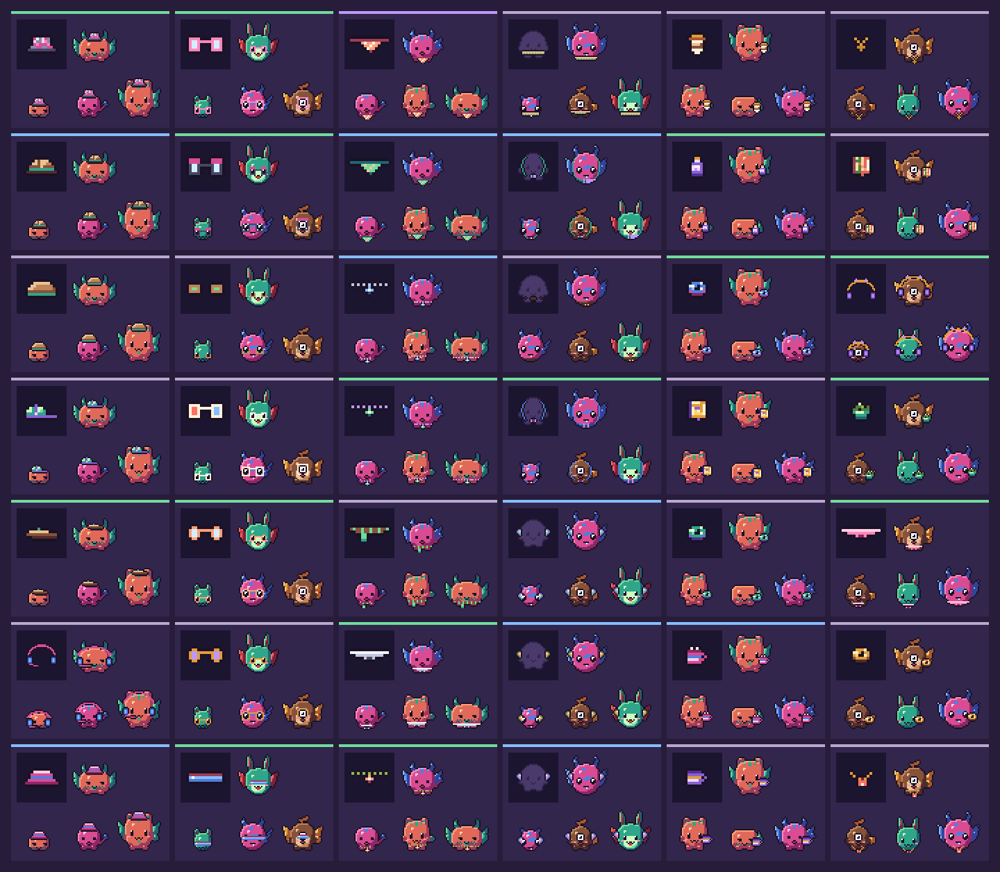

# Bits and the shop

Forklings earn **bits** by playing and spend them in the **shop**: six new items every night at 00:00 UTC, a few older ones brought back, and the twelve classics, which are always on sale. Bits can't be bought, transferred or cashed out. Every number below comes from `src/shared/economy.ts`, `src/shared/shopgen.ts` or `src/shared/distinct.ts`, and the tests hold them in place.



*A week of nights from `bun scripts/shop-sheet.ts`, using a public demo salt. The live shop uses a secret salt, so its items are different.*

## Where bits live

The wallet is an append-only ledger in each player's `PlayerDO` SQLite (`src/worker/wallet.ts`). Only the Durable Object changes a balance, and it changes it inside a transaction:

- Every entry has a unique key naming what it pays for: `battle:<id>:<side>`, `first-win:<day>`, `care:<day>`, `level:<n>`, `evolve:<stage>`, `start`, `buy:<requestId>`. A retried battle, care action or purchase hits the same key and pays or charges nothing more.
- `balance` is stored on each row with `CHECK (balance >= 0)`, so an overdraft fails the transaction rather than going negative.
- A purchase debits the wallet and adds the item to the inventory in one transaction. If either fails, both roll back.
- After each change the new rows are copied to D1 `bits_events` with `INSERT OR IGNORE`. That copy is for analytics only and is never read back to decide a balance. If the copy fails, the rows are kept in memory and sent with the next one. They're lost from analytics only if the Durable Object is evicted first; the ledger itself is never affected.

D1 also holds the catalogue (`shop_items`, `shop_days`), because every player has to see the same shelf.

## Earning

| What | Bits | Limit |
| --- | --- | --- |
| Starting balance (`START_BITS`) | 50 | Once. Existing players get 50 plus 10 per level above 1, at most 250, the first time they load the game after the shop arrives. |
| Win a battle you started | 12 | Full rewards for the first 12 rewarded battles in a UTC day. After that a win pays 3 and a draw or loss pays nothing. |
| Draw or lose a battle you started | 6 or 3 | As above. |
| Win when someone challenges you | 4 | A lost defence pays nothing. |
| First win of the day | 25 | Once per UTC day, attacking or defending. |
| A care action that leaves fullness, mood and energy all at 40 or above | 10 | Once per UTC day. |
| Reach a level | 5 + 2 × level | Level 2 pays 9, level 10 pays 25 and level 20 pays 45. Once per level. |
| Evolve to Junior, then Prime | 60, then 150 | Once each. |

Battle energy already limits play. A battle costs 15 energy and napping restores energy at a fixed rate, so even a Forkling that naps all day can fight at most 96 battles. The tests run real days of play through the real ledger:

| Player | Day | Bits a day | Common (40) | Uncommon (80) | Rare (150) | Epic (260) |
| --- | --- | --- | --- | --- | --- | --- |
| Casual | 3 battles, 2 wins, care | 62 | 0.6 days | 1.3 | 2.4 | 4.2 |
| Regular | 8 battles, 5 wins, care | 104 | 0.4 | 0.8 | 1.4 | 2.5 |
| Grinder | 96 battles, all won, care | 431 | 0.1 | 0.2 | 0.3 | 0.6 |

The bands the tests enforce (`test/unit/economy.test.ts`):

- A casual day buys a common item: 40 to 100 bits.
- Two regular days buy an uncommon.
- Grinding is tapered: the 96-battle maximum earns at most seven casual days (6.95 now).
- An Epic costs more than four casual days, and an Epic held item more than five.
- Levels 2 to 10 together pay less than one Epic, and so do both evolutions together.

## Prices and level locks

| Rarity | Chance | Price | Held price | Level to buy | Battle edge (held) |
| --- | --- | --- | --- | --- | --- |
| Common | 50% | 40 | 50 | 1–3 | +3% |
| Uncommon | 30% | 80 | 100 | 3–7 | +4% |
| Rare | 15% | 150 | 190 | 6–12 | +5% |
| Epic | 5% | 260 | 325 | 12–20 | +6% |

- A generated item's price is the base plus 0, 5 or 10, and its level is chosen within the range for its rarity.
- Held items cost a quarter more because they're the only gear that affects battles.
- Their edge is capped by the battle engine's existing `HELD_CAP_PCT` of 6%, which this work doesn't change. The task brief mentioned 8%, but the engine's 6% cap stays authoritative.
- Every night has at least one level-1 item a stage-0 Forkling shows: a head or face item, or body wear that stands out from the silhouette (cape, wings, tutu, backpack or hoodie). Babies are all head, with no torso below the mouth, so T-shirts, jumpers, dungarees and vests show on only about one baby in five; like neck and held items, they're for juniors and up. If the night's roll has no such item at level 1, its least rare one is dropped to level 1. `showsOnBaby()` in `src/shared/shopgen.ts` is the rule, and a unit test renders each night's level-1 item on 30 babies.
- A locked item says how far away it is: *Unlocks at level 7: 5 levels to go.*

The classics keep their original look. They now have prices and levels: beanie, glasses and mug at level 1; scarf at 2; bow tie and party hat at 3; headphones at 5; keyboard at 6; cap and shades at 8; duck at 10; crown at 15. The three starters still come free with every egg, and battle loot can still drop any classic at any level.

## The nightly shelf

The cron `5 0 * * *` builds the day's shelf (`ensureShopDay` in `src/worker/shop.ts`). If the cron is late or missed, the first shop request of the day does the same work. Both paths give the same result, and every write is `INSERT OR IGNORE`, so two Workers racing to make the same day agree.

**Seed.** `sha256("forklings-shop-v<SHOP_GEN_VERSION>|<day>|<salt>")`. The salt is the `SHOP_SALT` secret if set, or else a value derived from `HATCH_SALT`, so no new secret is needed to deploy. Nobody without the salt can compute tomorrow's items. The same day, salt and catalogue always give the same items (tested).

**Items.** One item for each slot (head, face, neck, body, held), plus one more for head, neck, held or body. Ids are `g<yyyymmdd><a–f>`.

**Generation.** Each candidate comes from one of 30 archetypes (beanie, top hat, hard hat, lens styles, scarf, lanyard, medal, hoodie, cape, wings, tutu, backpack, mug, laptop, plant, donut and more). Colours come only from the creature palette ramps, ink, cream and a white glint; epic items use the gold ramp for their accent. Patterns get likelier with rarity, and names are made from the ramp name, the pattern and the noun ("Frost checked top hat"). Nothing comes from an image model or an LLM.

**Distinctness.** Every candidate is drawn alone on the mannequin, then outlined and cropped (`lookOf`). It's compared with the items in its slot that matter tonight (below). The distance runs from 0 (identical) to 1: the mean per-pixel difference over the union of the two looks. A pixel present in only one look scores 1, a shared pixel scores its CIE76 colour difference ÷ 60 (capped at 1), and outline that's in both looks is ignored. The candidate is nudged up to a pixel each way to find the best alignment.

| Compared with | Must be at least | Why |
| --- | --- | --- |
| The classics, items from the last 28 days (`RECENT_DAYS`) and tonight's returning items | 0.2 (`MIN_ITEM_DISTANCE`) | Everything on sale at once, and everything in a month's shop, differs in shape or pattern, or has the same shape in clearly different colours. |
| Every item ever made | Not an exact repeat (`drawKey`, `lookKey`) | No item is ever made twice. |
| Names from the last 28 days, tonight's returning items and the classics | Not equal | Two "Cocoa tutu"s in a week read as the same item, however different they look. |

The exact-repeat rule uses two short hashes stored with each item: `draw_key`, of exactly what the item is drawn from, and `look_key`, of the drawn look, because two different definitions can come out pixel for pixel the same. A candidate is checked by name and `drawKey` before it's drawn, so those refusals cost almost nothing.

A rejected candidate is replaced by another from the same seeded stream, with up to 40 tries per slot (`MAX_ATTEMPTS`). If a slot runs out of tries, it is left empty for that night and one more older item is brought back to fill the gap.

**Why a bounded set.** The first version also held every new item 0.1 away from everything ever made. That made a night's cost grow with the whole catalogue (about 0.28 s of CPU after a year and rising) and ran slots dry faster. The guarantee players can see is that nothing on sale looks like anything else on sale and a month of shops doesn't repeat itself; the bounded rule gives exactly that, plus no exact repeat ever. An item made more than 28 days ago can now have a near lookalike (closer than 0.2, never identical) in a later month, but the two are never on the shelf together.

**Coming back.** Each night also brings back four older items (`RESURFACED_PER_DAY`), chosen by the seed from those that haven't been on the shelf in the last seven days. They're tagged *Back*. Returning items are chosen before the new ones: each must be 0.2 away from the classics, the last 28 days and the other returning items, and its name must be free. The Worker loads the first 30 in the seed's order (`BACK_CANDIDATES`) and takes those that pass. A purchase in the first ten minutes after midnight can still use the previous shelf, so a page left open over 00:00 doesn't fail.

**Fit.** Every item is drawn onto real creatures in the tests. Each one must show on at least 97% of creatures at the stages that show its slot, and it can't change any pixel more than one pixel away from itself. A one-pixel outline seam can open at the edge. Any head item hides a crest (fins and sprouts), as hats always have. Neck and held items appear from the first evolution, and the fitting room tells a stage-0 player so. A held item's battle edge still applies before it shows.

## Capacity and CPU

`bun scripts/shop-bench.ts [nights]` simulates nights from 22 October 2026 the way `ensureShopDay` does, with the D1 rows in memory, and times each night's CPU: decoding the 28-day window and the key index, choosing returning items, generating, and encoding what's stored. D1 round trips are I/O and aren't counted. Under Node (V8, the engine Workers use) on the dev host:

| Night | Catalogue | Steady state | Cold isolate |
| --- | --- | --- | --- |
| 30 | 180 | 10 ms | 47 ms |
| 180 | 1,080 | 10 ms | 53 ms |
| 365 | 2,137 | 10 ms | 66 ms |
| 400 | 2,315 | 10 ms (worst night 24 ms) | |
| 730 | 3,538 | 10 ms (worst night 27 ms) | |

The cold column is one night in a fresh process, as a once-a-day cron usually gets; most of it is the JavaScript engine warming up, not the catalogue. For comparison, the first version took 280 ms steady-state and 530 ms cold at night 365, and was still climbing. Two changes did it: the bounded comparison set, and precomputed features. Each look is turned once into an array of colour ids with a table of colour distances, the classics' looks are precomputed in `src/shared/classic-looks.ts`, and the per-pixel outline pass in `compose` no longer allocates. That last one makes every sprite draw about three times faster, with identical pixels.

Run end to end in `wrangler dev` against a local D1 seeded with 365 nights (2,130 items), the cron made the night in 93 ms of wall time, D1 included.

- **What still grows.** The Worker reads `id, draw_key, look_key` for every item (about 40 bytes a row, 90 KB after a year) and builds a lookup from it. That's well under a millisecond a night at a year and stays small. Everything else it reads (the last 28 days, up to 30 returning candidates) is bounded.
- **Running dry.** The exact-repeat rule slowly uses up each slot's design space. Over 400 nights 85 of 2,400 slots (3.5%) came up short, against 11% with the old rule; over two years it's 842 of 4,380 (19%). Returning items fill every gap, so the shelf never shrinks. When the shortfall matters, add archetypes or styles in the slots that run dry and bump `SHOP_GEN_VERSION`.
- **Plan.** Generation needs more than the Workers Free plan's 10 ms of CPU, so the shop needs Workers Paid, where a daily Cron Trigger gets 15 minutes of CPU and a request 30 seconds by default ([Workers limits](https://developers.cloudflare.com/workers/platform/limits/)). The cron does it once a day, and a request does it only when the cron hasn't run yet.

## House NPCs

At the first NPC tick after 00:20 UTC, each NPC may buy one thing (`npcPick`):

- the cheapest new or returning cosmetic it can afford, is high enough level for and doesn't own yet;
- never a held item and never a classic, so NPC battle strength doesn't change.

NPCs then wear what they buy. They earn bits through the same ledger as players, flagged `npc = 1` in `bits_events`.

## API

- `GET /api/shop` returns the shelf, the wallet, today's earnings against each daily limit, and the restock time. The first call of the day can make the day's items.
- `POST /api/shop/buy` takes `{ item, requestId }`. `requestId` comes from the client, with one per buy tap, matching `[A-Za-z0-9_-]{8,64}`. The response has the result and the player view at the top level:
  - `ok: true`, with `replay: true` on a repeat of a request that already succeeded;
  - or `ok: false` with `code`: `locked`, `owned`, `poor`, `gone` (not on today's shelf), or `request` (a bad id, or an id reused for another item).
- A cross-site POST is refused.
- Owned generated items equip through the existing `/api/equip`. Their definitions travel with the inventory and with battle snapshots, so replays draw them, and any held effect counts in battles exactly as the battle engine's own items do.

## Analytics

```sql
-- Where bits come from and go, by day
SELECT day, kind, SUM(delta) AS bits, COUNT(*) AS n FROM bits_events WHERE npc = 0 GROUP BY day, kind ORDER BY day;

-- Best-selling items, with their rarity and price
SELECT b.ref AS item, s.rarity, s.price, COUNT(*) AS sold FROM bits_events b LEFT JOIN shop_items s ON s.id = b.ref
WHERE b.kind = 'buy' AND b.npc = 0 GROUP BY b.ref ORDER BY sold DESC;

-- How each night's generation went
SELECT day, made, rejected, short, ms FROM shop_days ORDER BY day DESC;

-- Win rate by held item, including generated ones
SELECT held, AVG(won) AS win_rate, COUNT(*) AS n FROM battle_sides WHERE won IS NOT NULL AND bot = 0 AND npc = 0 GROUP BY held;
```

## Operations

- **Migrations.** `migrations/0005_shop.sql` (after `0004_oauth.sql`) adds `shop_items` (with `draw_key` and `look_key`), `shop_days`, `bits_events` and `battle_sides.body`. Player wallets create their own tables when first opened.
- **Changing a classic's art.** Run `bun scripts/classic-looks.ts && npm run format` to refresh the precomputed looks; a unit test fails until you do.
- **Changing the generator.** Bump `SHOP_GEN_VERSION` whenever it changes its output for a seed. Stored days and items are never regenerated, and each item's version is kept in `shop_items.gen_version`.
- **Remaking a day locally:**

  ```sh
  wrangler d1 execute forklings-db --local --command "DELETE FROM shop_items WHERE day = 'YYYY-MM-DD'; DELETE FROM shop_days WHERE day = 'YYYY-MM-DD'"
  ```

  Never do this in production once anyone has bought from that day.
- **Contact sheet.** `bun scripts/shop-sheet.ts [nights]` writes `docs/assets/shop-week.png` and prints the week as a table.
- **Testing the crons.** `test/unit/scheduled.test.ts` fires both crons through the Worker's `scheduled()` against an in-memory D1 with every migration applied. To fire one against local D1 by hand, run `wrangler dev --test-scheduled` and request `/__scheduled?cron=5+0+*+*+*` (the shop) or `/__scheduled?cron=*/20+*+*+*+*` (NPCs).
